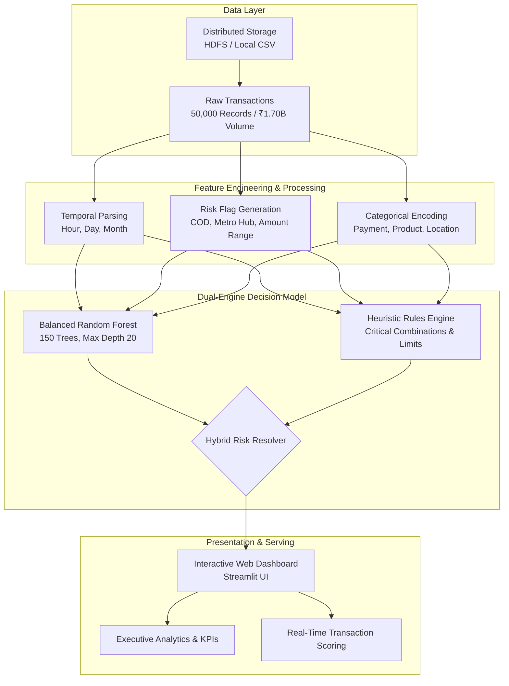
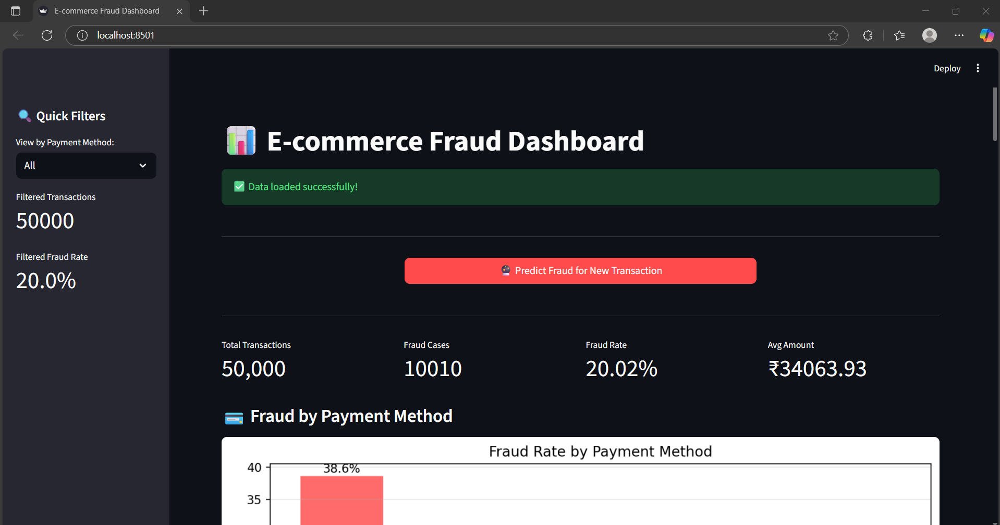
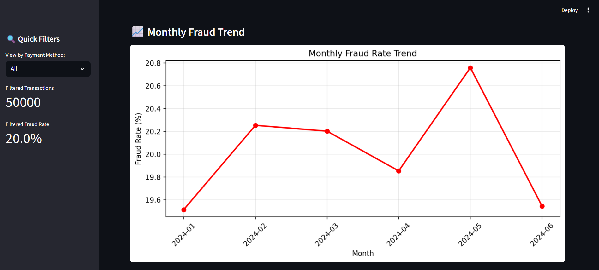
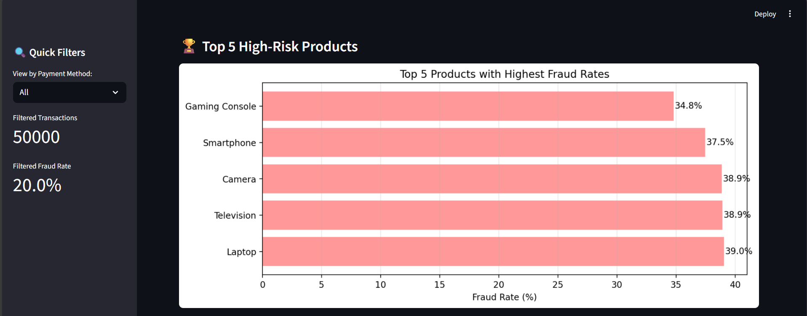
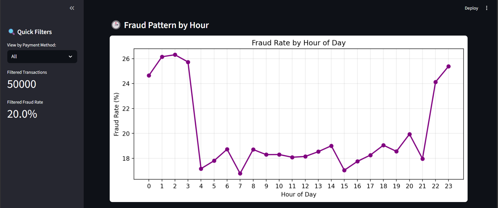
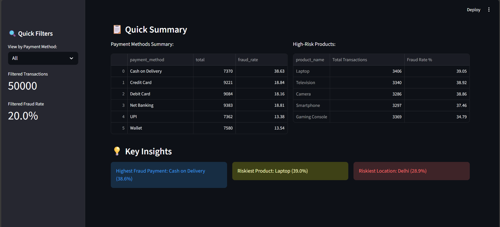

# 🛒 E-commerce Transaction Analysis & Real-Time Fraud Detection System

[](https://www.python.org/)
[](https://streamlit.io/)
[](https://scikit-learn.org/)
[](https://spark.apache.org/)
[]()

An end-to-end Big Data & Machine Learning system designed to analyze high-throughput e-commerce transaction patterns, detect fraudulent transactions, and provide real-time risk assessment via an interactive web dashboard.

---

## 📌 Table of Contents
- [Overview & Objectives](#-overview--objectives)
- [System Architecture](#-system-architecture)
- [Key Features](#-key-features)
- [Dataset Summary & Statistics](#-dataset-summary--statistics)
- [Machine Learning & Hybrid Engine](#-machine-learning--hybrid-engine)
- [Performance & Evaluation Metrics](#-performance--evaluation-metrics)
- [Project Structure](#-project-structure)
- [Installation & Setup](#-installation--setup)
- [Running the Application](#-running-the-application)
- [Dashboard Walkthrough & Screenshots](#-dashboard-walkthrough--screenshots)
- [Tech Stack](#-tech-stack)

---

## 🔍 Overview & Objectives

In modern e-commerce platforms, payment fraud poses significant financial and reputational threats. Fraudulent behaviors constantly evolve and exhibit nuanced patterns:
- Orders for **high-value electronics** placed using **Cash on Delivery (COD)**.
- Spikes in fraud originated from specific high-density metropolitan delivery zones.
- Micro-transactions or irregular amount splits designed to test stolen credentials.

This project implements a **dual-layer fraud defense architecture**:
1. **Machine Learning Layer**: A balanced Random Forest Classifier trained on behavioral and transactional attributes.
2. **Heuristic Rule Override Engine**: Deterministic business rules that intercept edge cases and high-risk combinations where ML confidence alone might have blind spots.
3. **Interactive Analytics & Inference Dashboard**: Built with Streamlit for executive trend visualization, exploratory data analysis, and instant single-transaction fraud evaluation.

---

## 🏗 System Architecture



---

## ✨ Key Features

- **Real-Time Fraud Scoring**: Enter transaction details (product, amount, payment method, location) and receive immediate predictions with risk categorization (`LOW`, `MEDIUM`, `HIGH`, `VERY HIGH`).
- **Interactive Visual KPIs**: Instant visibility into Total Transactions, Fraud Rate, Total Value, and Average Order Value.
- **Dimensional Fraud Breakdown**:
  - **Payment Method Risk**: Visualizing vulnerability of COD vs. UPI vs. Cards vs. Net Banking.
  - **Temporal Patterns**: Monthly trends and hourly fraud distributions (00:00 to 23:00).
  - **Product Vulnerability Ranking**: Highlighting top 5 most exploited product categories.
  - **Geographical Hotspots**: Pinpointing cities with disproportionate fraudulent activity.
- **Rule Override Transparency**: Clear explanation in the UI whenever a deterministic rule triggers an override.

---

## 📈 Dataset Summary & Statistics

The model is built and tested against **50,000 transaction records** simulating realistic Indian e-commerce consumer behavior:

| Metric | Value |
| :--- | :--- |
| **Total Transactions** | `50,000` |
| **Total Transaction Value** | `₹1,703,196,445` (~**₹1.70 Billion**) |
| **Fraud Cases** | `10,010` (**20.02%** fraud prevalence) |
| **Transaction Amount Range** | Min: `₹800.00` \| Mean: `₹34,063.93` \| Max: `₹149,971.00` |
| **Payment Channels** | Cash on Delivery, Credit Card, Debit Card, Net Banking, UPI, Wallet |
| **Geographic Coverage** | 18+ major metropolitan & tier-2 cities across India |

### Key Risk Insights from EDA
* **Cash on Delivery (COD)** exhibits the highest fraud rate at **38.63%**, compared to **UPI (13.38%)** and **Digital Wallets (13.54%)**.
* **High-Value Electronics** suffer the highest fraud concentration:
  - Laptops: **39.05%**
  - Televisions: **38.92%**
  - Cameras: **38.86%**
  - Smartphones: **37.46%**
  - Gaming Consoles: **34.79%**
* **Top 3 High-Risk Cities**: Delhi (**28.95%**), Mumbai (**28.43%**), Kolkata (**27.20%**).

---

## 🤖 Machine Learning & Hybrid Engine

### 1. Engineered Features
To enrich transaction signals, domain-specific features were created:
* `is_high_value_product`: Binary flag for luxury electronics (Laptops, Cameras, Consoles, etc.).
* `is_high_risk_payment`: Binary flag specifically targeting Cash on Delivery.
* `is_high_risk_location`: Flag indicating top fraud hubs (Delhi, Mumbai, Kolkata).
* `is_very_high_amount`: Flag for transactions exceeding ₹50,000.
* `is_suspicious_amount`: Flag for decimal anomalies or amounts $\le$ ₹10.

### 2. Random Forest Hyperparameters
```python
RandomForestClassifier(
    n_estimators=150,        # 150 ensemble decision trees
    max_depth=20,            # Constrains overfitting while capturing deep feature interactions
    min_samples_split=10,    # Ensures generalizeable branch splits
    min_samples_leaf=5,      # Regularizes leaf predictions
    class_weight='balanced', # Penalizes false negatives on minority fraud class
    random_state=42,
    n_jobs=-1                # Parallelizes computation across all CPU cores
)
```

### 3. Feature Importance Distribution
1. **Transaction Amount**: `35.82%`
2. **High-Value Product Flag**: `21.63%`
3. **Payment Method**: `11.54%`
4. **Location**: `9.12%`
5. **High-Risk Payment Flag**: `7.59%`
6. **Product Category**: `6.02%`
7. **Very High Amount Flag**: `4.80%`
8. **High-Risk Location Flag**: `3.47%`

### 4. Expert Rule Overrides
```text
IF Product is High-Value AND Payment is COD AND Amount > ₹50,000  --> Flag Fraud (Probability >= 90%)
IF Product is High-Value AND Payment is COD AND Location in Tier-1 Metro --> Flag Fraud (Probability >= 85%)
IF Product is High-Value AND Amount <= ₹1                          --> Flag Fraud (Probability >= 95%)
IF Active Risk Factors Count >= 3                                  --> Flag Fraud (Probability >= 75%)
```

---

## 🎯 Performance & Evaluation Metrics

Evaluated on an **independent 20% holdout test set (10,000 transactions)**:

| Metric | Result | Impact |
| :--- | :--- | :--- |
| **Fraud Recall** | **71.63%** | Captures over 7 out of 10 fraud attempts |
| **Legitimate Precision** | **90.00%** | Minimizes customer friction for valid orders |
| **ROC-AUC Score** | **0.7486** | Solid discriminatory capability across probability thresholds |
| **Overall Accuracy** | **67.32%** | Balanced trade-off tuned for fraud detection sensitivity |

---

## 📁 Project Structure

```text
E-commerce Transaction Analysis and Fraud Detection/
├── Project Dataset/
│   └── ecommerce_transactions_dataset.csv   # 50,000 transaction dataset
├── Project IDE/
│   ├── project_dashboard.py                 # Core Streamlit app & ML pipeline
│   ├── evaluation.py                        # Model evaluation & business impact metrics
│   ├── sample_dashboard.py                  # PySpark / HDFS distributed implementation
│   └── run_evaluation.py                    # Standalone evaluation execution script
├── Screenshots/                             # Comprehensive UI captures
│   ├── 1.png - 22.png                       # Visual walk-through & dashboard charts
├── .streamlit/
│   └── config.toml                          # Streamlit server & port configuration
├── requirements.txt                         # Python dependencies
├── run.bat                                  # One-click Windows launch script
└── README.md                                # Project documentation
```

---

## 🚀 Installation & Setup

### Prerequisites
- Python 3.10, 3.11, or 3.12 installed.
- Git installed.

### Step 1: Clone the Repository
```bash
git clone https://github.com/your-username/ecommerce-fraud-detection.git
cd ecommerce-fraud-detection
```

### Step 2: Create a Virtual Environment
```bash
# Windows
python -m venv .venv
.\.venv\Scripts\activate

# macOS / Linux
python3 -m venv .venv
source .venv/bin/activate
```

### Step 3: Install Dependencies
```bash
pip install -r requirements.txt
```

---

## 🖥 Running the Application

### Option A: One-Click Windows Launcher
Double-click `run.bat` in the root folder, or run:
```cmd
run.bat
```

### Option B: Using the Streamlit CLI
```bash
streamlit run "Project IDE/project_dashboard.py"
```

Once launched, open your browser at:
```text
Local URL: http://localhost:8501
```

---

## 📸 Dashboard Walkthrough & Screenshots

### 1. Executive Summary & KPIs
The dashboard loads transaction summaries and monitors critical risk indicators in real time:



### 2. Fraud Vulnerability by Payment Method & Monthly Trend
Visualizing the heightened risk of Cash on Delivery versus digital payment options:



### 3. Top High-Risk Products & Geographic Locations
Identifying top categories (laptops, TVs) and high-fraud metropolitan delivery zones:



### 4. Real-Time Single Transaction Scoring Form
Enables operators to input transaction attributes and obtain an instant risk prediction and explanation:




---

## 🛠 Tech Stack

- **Language**: Python 3.12
- **Big Data & Distributed Computing**: Apache Spark (PySpark), Apache Hadoop (HDFS)
- **Machine Learning**: Scikit-Learn (Random Forest Classifier, Preprocessing, Metrics)
- **Data Manipulation**: Pandas, NumPy
- **Interactive Web UI**: Streamlit
- **Data Visualization**: Matplotlib, Seaborn

---

## 📜 License
This project is open-source and available under the [MIT License](LICENSE).

